## v0.3.0
Breaking Change: ⚠️
New Feature: 🆕 for ver0.3.x

  - Rework the layout implementation of `enum` and `list`
    - Each list item now uses the native `enum` (Typst 0.15.1) to align the baselines of the label and body
    - Revise some default behaviors:
      - Labels on the same line are now aligned with the list
      - If the label has no baseline, bottom alignment is used by default (which better fits common usage)
    
      
      <details>
      <summary>Code:</summary>

      ```typst
      #set page(height: auto, margin: 15pt, width: 12cm)

      #import "@local/itemize:0.3.0" as el
      #let test = [
        + + $vec(1, 1, 1)$ #lorem(2)
        #set list(marker: _ => { circle(width: 2em) })
        - #lorem(2)
      ]
      #table(
        columns: (1fr, 1fr),

        table.header([*Native*], [*Itemize*]),
        [#test],
        [
          #show: el.default-enum-list
          #test
        ],
      )
      ```
      </details>
  - 🆕 Add the `inline-enum-list` (`inline-enum`, `inline-list`) layout, which does not use `block` elements and instead interprets the list content as paragraphs
    - In particular, any `block` elements appearing in the list are laid out flush left
    - Content at every level of the list spans the full width of the parent container
    - Because of this paragraph behavior, some features of `default-enum-list` (`default-enum`, `default-list`) no longer take effect

    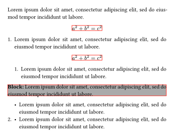 
    <details>
    <summary>Code:</summary>

    ```typst
    #set page(height: auto, margin: 15pt, width: 12cm)

    #import "@local/itemize:0.3.0" as el

    #show: el.inline-enum-list
    #set par(justify: true)
    #set block(stroke: red) // debug
    #lorem(15)
    $ a^2 + b^2 = c^2 $
    + #lorem(15)
      $ a^2 + b^2 = c^2 $
      + #lorem(15)
      #block(fill: gray)[
        *Block: *
        #lorem(15)
      ]
      - #lorem(15)
    + - #lorem(15)
    ```
    </details>
  - 🆕 Support for `description` lists:
    - Using the syntax `+ / terms: description` and `- / terms: description`
    - Horizontal description list, hanging description list, stacked description list, plain description list
    - Freely configurable via the `description-config` parameter
    - Support checklist style for description list (requires setting `checklist` to `true` in `description-config`)

     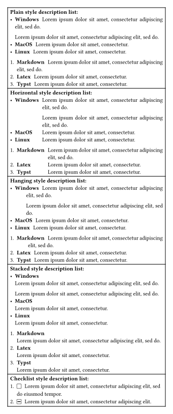
     <details>
     <summary>Code:</summary>

     ```typst
     #set page(height: auto, margin: 15pt, width: 12cm)

     #import "@local/itemize:0.3.0" as el

     #let test = [
       #set par(justify: true)
       - / #box([Windows]): #lorem(10)

           #lorem(10)
       - / MacOS: #lorem(6)
       - / Linux: #lorem(6)
       + / Markdown: #lorem(10)
       + / Latex: #lorem(6)
       + / Typst: #lorem(6)
     ]

     #let desc-list(body, ..args) = el.default-enum-list(
       description-config: (
         enable-first-par: false,
         term-format: (strong,),
         ..args.named(),
       ),
       body,
     )

     #table(
       [
         *Plain style description list: *
         #desc-list[#test]
       ],
       [
         *Horizontal style description list: *
         #desc-list(style: "horizontal")[#test]
       ],
       [
         *Hanging style description list: *
         #desc-list(style: "hanging")[#test]
       ],
       [
         *Stacked style description list: *
         #desc-list(style: "stacked", separator: (prefix: context block(above: 0pt, below: par.leading)))[#test]
       ],
       [
         #show: el.default-enum-list.with(
           checklist: true,
           description-config: (
             term-format: (strong,),
             checklist: true,
           ),
         )
         *Checklist style description list: *
         + / [ ]: #lorem(12)
         + / [-]: #lorem(8)
       ],
     )
     ```
     </details>
  - Enhance `label-baseline` settings:
    - 🆕 Allow `label-baseline: (impact-first-line: true)` to make the label's baseline and height affect the first line of the body
    - 🆕 Allow setting `label-baseline` to `"top-item"`, `"horizon-item"`, and `"bottom-item"` to align the label to the top, horizontal, or bottom of the whole item respectively
    - 🆕 New attribute `relative-to(at, shift, to)` lets users shift the label relative to the baseline
    - 🆕 New attribute `same-line-style` lets users set baseline of the label and body when they appear on the same line
    - 🆕 New attribute `at` lets users set the alignment position of the label
  
    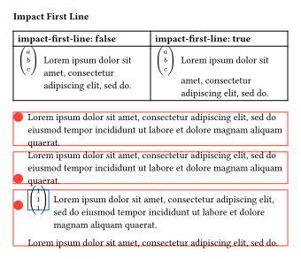 
    <details>
    <summary>Code:</summary>

    ```typst
    #set page(height: auto, margin: 15pt, width: 12cm)

    #import "@local/itemize:0.3.0" as el
    #let test = [
      + #el.item([$vec(a, b, c)$]) #lorem(10)
    ]
    *Impact First Line*
    #table(
      columns: (1fr, 1fr),
      table.header([*impact-first-line: false*], [*impact-first-line: true*]),
      [
        #show: el.default-enum-list
        #test
      ],
      [
        #show: el.default-enum-list.with(label-baseline: (impact-first-line: true))
        #test
      ],
    )
    #set list(marker: [#circle(width: 1em, fill: red)])
    #show: el.default-enum-list.with(body-format: (stroke: (red, auto)))
    #[
      - #el.item(label-baseline: "center") #lorem(20)
    ]
    #[
      - #el.item(label-baseline: "bottom-item") #lorem(20)
    ]
    #[
      - #el.item(label-baseline: (same-line-style: "bottom-label"))
        - #el.item(label-format: (stroke: blue), [$vec(1, 1, 1)$]) #lorem(20)
        #lorem(10)
    ]
    ```
    </details>
  - Enhance the paragraph model
    - The `line-indent` and `hanging-indent` parameters are independent of `set par(first-line-indent, hanging-indent)`
    - Add the `first-line-inset` parameter to control the indentation of the first line of each list item
    - (*minor change*) Paragraphs inside `block-level` elements that appear in the list are not processed (the related settings are not yet exposed)
    - 🆕 For the `default-*` methods, add the `hanging-type` parameter to set the hanging indent type

    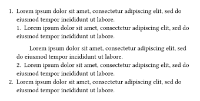 
    <details>
    <summary>Code:</summary>

    ```typst
    #set page(height: auto, margin: 15pt, width: 12cm)

    #import "@local/itemize:0.3.0" as el

    #show: el.default-enum-list.with(
      line-indent: 2em,
      hanging-type: ("classic", "paragraph", auto),
    )
    + #lorem(15)
      + #lorem(15)

        #lorem(15)
      + #lorem(15)
    + #lorem(15)
    ```
    </details>
  - Enhance the `label` model (enhance `label-format` parameter)
    - 🆕 Allow adding borders to labels without disrupting the baseline alignment between the label content and body
    - (*minor change*) `label-indent` now allows horizontal displacement of labels without affecting label width
    - 🆕 `label-inset` now lets you translate labels horizontally (without affecting the label width and the inset of the first line)
    - 🆕 The `width-style` (`height-style`) attributes in `label-format` allow the label width (height) to be set independently
   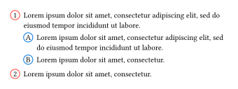

   <details>
   <summary>Code:</summary>

   ```typst
   #set page(height: auto, margin: 15pt, width: 12cm)

   #import "@local/itemize:0.3.0" as el

   #show: el.default-enum-list.with(
     // body-format: (stroke: red), // debug
     label-format: (
       stroke: (red, blue),
       align: center + horizon,
       width-style: (amount: 1.2em, stretched: true),
       height-style: (amount: 1.2em, stretched: true),
       radius: 1em,
     ),
   )
   #set enum(numbering: "1.A")
   + #lorem(15)
     + #lorem(15)
     + #lorem(6)
   + #lorem(6)
   ```
   </details>

  - 🆕 Add `step` for setting the step size of enum numbers

     
    <details>
    <summary>Code:</summary>

    ```typst
    #set page(height: auto, margin: 15pt, width: 12cm)

    #import "@local/itemize:0.3.0" as el

    #let factorial-step = (..nums) => {
      let numbers = nums.pos()
      let n = numbers.len()
      if n >= 2 {
        return numbers.at(n - 2) + numbers.at(n - 1)
      }
    }
    #[
      Make enum numbers like factorial: \
      $a_n = a_(n - 2) + a_(n - 1)$, $a_1 = 1, a_2 = 1$.
      #show: el.default-enum-list.with(step: (factorial-step,))
      1. #lorem(2)
      2. #lorem(2)
      + #lorem(2)
      + #lorem(2)
      + #lorem(2)
      + #lorem(2)
    ]
    #[
      Increment enum numbers by a step of 2:
      #show: el.default-enum-list.with(step: 2)
      1. #lorem(2)
      + #lorem(2)
      + #lorem(2)
      + #lorem(2)
    ]
    ```
    </details>
  - 🆕 Add different compact modes: `tight-mode`, `tight-item-mode`
    - Use `#show: el.config.auto-detect-tight` to enable a compact mode between the list and the paragraph below it; native `enum` and `list` elements currently only support a compact mode between the list and the paragraph above it

    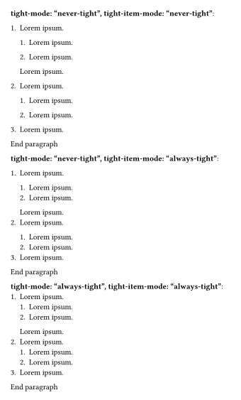
    <details>
    <summary>Code:</summary>

    ```typst
    #set page(height: auto, margin: 15pt, width: 12cm)

    #import "@local/itemize:0.3.0" as el
    #let test = [
      + #lorem(2)
        + #lorem(2)
        + #lorem(2)
        #lorem(2)
      + #lorem(2)
        + #lorem(2)
        + #lorem(2)
      + #lorem(2)
      End paragraph
    ]
    #[
      #show: el.default-enum-list.with(tight-mode: "never-tight", tight-item-mode: "never-tight")
      *tight-mode: "never-tight", tight-item-mode: "never-tight"*:
      #test
    ]

    #[
      #show: el.default-enum-list.with(tight-mode: "never-tight", tight-item-mode: "always-tight")
      *tight-mode: "never-tight", tight-item-mode: "always-tight"*:
      #test
    ]

    #[
      #show: el.default-enum-list.with(tight-mode: "always-tight", tight-item-mode: "always-tight")
      *tight-mode: "always-tight", tight-item-mode: "always-tight"*:
      #test
    ]
    ```
    </details>

      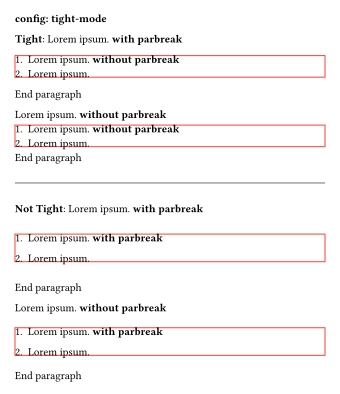

    <details>
    <summary>Code:</summary>

    ```typst
    #set page(height: auto, margin: 15pt, width: 12cm)

    #import "@local/itemize:0.3.0" as el

    #let first-level-tight-mode = (
      tight: (auto, 0.65em),
      par-tight: (auto, auto),
      not-tight: (1.5em, 1.5em),
      par-not-tight: (2em, 2em),
    )
    #show: el.default-enum-list.with(
      tight-mode: (first-level-tight-mode, (tight: auto, not-tight: 2em)),
      body-format: (whole: (stroke: red)),
    )
    #show: el.config.auto-detect-tight

    *config: tight-mode*

    *Tight*: #lorem(2) *with parbreak*

    + #lorem(2) *without parbreak*
    + #lorem(2)
    End paragraph

    #lorem(2) *without parbreak*
    + #lorem(2) *without parbreak*
    + #lorem(2)
    End paragraph
    #divider()
    *Not Tight*: #lorem(2) *with parbreak*

    + #lorem(2) *with parbreak*

    + #lorem(2)
    End paragraph

    #lorem(2) *without parbreak*
    + #lorem(2) *with parbreak*

    + #lorem(2)
    End paragraph
    ```
    </details>
    
    - fix: https://github.com/tianyi-smile/itemize/issues/5

  - Enhance label referencing functionality
    - 🆕 Allow using `ref-numbering` and `supplement` to set different enum label references
    - Enhance `supplement` functionality in `config.ref`, now supporting `dictionary`, `function`, `array`
    - fix: https://github.com/tianyi-smile/itemize/issues/19
    - 🆕 New reference mode
      - Set `full` to `"rel"` in `config.ref` to use relative mode for label references, meaning that if the current item and the referenced item share the same parent level, that shared parent level is not displayed.
        - solve: https://github.com/tianyi-smile/itemize/issues/9
      - If you use `item` to change the current list's label content, referencing this content is now supported, which is very useful for academic paper writing.
    
      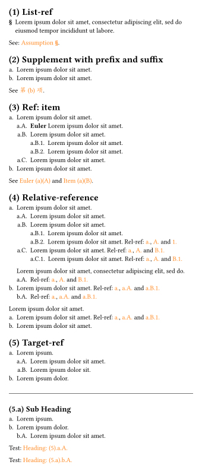
      <details>
      <summary>Code:</summary>

      ```typst
      #set page(height: auto, margin: 15pt, width: 12cm)

      #import "@local/itemize:0.3.0" as el

      #show link: set text(fill: orange)

      #show: el.default-enum-list
      #set enum(numbering: "a.A.1.", full: true)
      #set heading(numbering: "(1.a)")
      #show: el.config.ref
      = List-ref
      - #el.item([*#sym.section*], supplement: ([Assumption],))<l:my> #lorem(15)
      See: @l:my.

      = Supplement with prefix and suffix
      #[
        #show: el.config.ref.with(supplement: (prefix: [第], suffix: [项]), numbering: "(a).(A)")
        + #lorem(5)
        + #lorem(5) <item:mya>
        See @item:mya.
      ]

      = Ref: item
      + #lorem(5)
        + #el.item(ref-numbering: "(a)(A)", supplement: [Euler])<item:a> *Euler*  #lorem(5)
        + #lorem(5) <item:b>
          + #lorem(5)
          + #lorem(5)
        + #lorem(5)
      + #lorem(5)

      See @item:a and @item:b[Item].
      = Relative-reference
      #show: el.config.ref.with(full: "rel")
      + #lorem(5) <p:a>
        + #lorem(5) <p:b>
        + #lorem(5)
          + #lorem(5) <p:c>
          + #lorem(5) Rel-ref: @p:a, @p:b and @p:c
        + #lorem(5) Rel-ref: @p:a, @p:b and @p:c
          + #lorem(5) Rel-ref: @p:a, @p:b and @p:c
        #lorem(10)
        + Rel-ref: @p:a, @p:b and @p:c
      + #lorem(5) Rel-ref: @p:a, @p:b and @p:c
        + Rel-ref: @p:a, @p:b and @p:c
      #lorem(5)
      + #lorem(5) Rel-ref: @p:a, @p:b and @p:c
      + #lorem(5)

      #[
        #show: el.default-enum-list.with(
          supplement: it => {
            [Heading: #numbering(heading.numbering, ..counter(heading).at(it.target)).#it.body]
          },
        )

        #show: el.config.ref.with(full: true)

        = Target-ref
        + #lorem(2)
          + #lorem(5) <item:testa>
          + #lorem(4)
        + #lorem(3)
        #divider()
        == Sub Heading
        + #lorem(2)
        + #lorem(3)
          + #lorem(5) <item:testb>

        Test: @item:testa

        Test: @item:testb
      ]
      ```
      </details>

  - 🆕 `item-spacing` now accepts a `dictionary` of the form `(above: len1, below: len2)`. The spacing between the current item and the following item increases by `below`, while the spacing between the current item and the preceding item increases by `above`.
    - Its behavior differs from setting `item-spacing` to a `length`; when `(above: len1, below: len2)` is specified, the spacing is guaranteed to increase.

    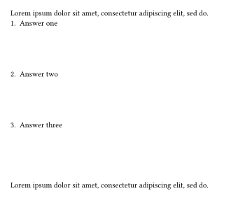 
    <details>
    <summary>Code:</summary>

    ```typst
    #set page(height: 10cm, margin: 15pt, width: 12cm)

    #import "@local/itemize:0.3.0" as el

    #show: el.default-enum-list.with(item-spacing: (below: 1fr))
    #lorem(10)
    + Answer one
    + Answer two
    + Answer three
    #lorem(10)
    ```
    </details>
  - 🆕 Enhance the `item` method
    - Allow using the `item` method to change the current list settings, supporting most style options
      - Setting `for-elem` to `true` applies the style to the whole list (Only when writing `item` in the first item); by default it applies only to the current item
      - It is not supported to fold the style of `for-elem` to `true` with the style of `item` in other items
  
      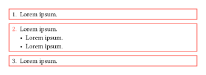 
      <details>
      <summary>Code:</summary>

      ```typst
      #set page(height: auto, margin: 15pt, width: 12cm)

      #import "@local/itemize:0.3.0" as el


      #show: el.default-enum-list
      + #el.item(body-format: (outer: (stroke: red, inset: 5pt)), for-elem: true) #lorem(2)
      + #el.item(fill: red) #lorem(2)
        - #lorem(2)
        - #lorem(2)
      + #lorem(2)
      ```
      </details>
    - Allow using `item` to set `tag` and `elem-tag` attributes, then format items or lists with these attributes.

        
      <details>
      <summary>Code:</summary>

      ```typst
      #set page(height: auto, margin: 15pt, width: 12cm)

      #import "@local/itemize:0.3.0" as el

      #show: el.default-enum-list.with(
        body-format: (
          inner: (
            format: it => {
              if it.tag == "emph" {
                set text(fill: red)
                show: emph
                it.body
              } else {
                it.body
              }
            },
          ),
          whole: (
            stroke: it => if it.elem-tag == "stroke:red" { red } else { auto },
          ),
        ),
        label-format: it => {
          if type(it.tag) == array {
            let fmt-strong = body => {
              if "strong" in it.tag {
                set text(fill: orange)
                show: strong
                body
              } else {
                body
              }
            }
            let fmt-highlight = body => {
              if "highlight" in it.tag {
                show: highlight
                it.body
              } else {
                body
              }
            }
            fmt-strong(fmt-highlight(it.body))
          } else {
            it.body
          }
        },
      )
      + #lorem(2)
      + #el.item(tag: "emph") #lorem(2)
      + #lorem(2)
        + #el.item(tag: ("strong",), elem-tag: "stroke:red") #lorem(2)
        + #el.item(tag: ("strong", "highlight")) #lorem(2)
        + #lorem(2)
      ```
      </details>
  - (*minor change*) Move the functionality of `item-format` from v0.2.0 to `body-format`, now allowing labels and bodies to be formatted simultaneously with more intuitive behavior
    - Remove the `item-format` parameter

    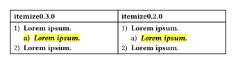
    <details>
    <summary>Code:</summary>

    ```typst
    #set page(height: auto, margin: 15pt, width: 12cm)

    #import "@local/itemize:0.3.0" as el

    #set enum(numbering: "1.a)")
    #table(
      columns: (1fr, 1fr),
      table.header([*itemize0.3.0*], [*itemize0.2.0*]),
      [
        #show: el.default-enum-list.with(
          body-format: (
            inner: (strong, emph, auto),
            whole: (auto, highlight, auto),
          ),
        )
        + #lorem(2)
          + #lorem(2)
        + #lorem(2)
      ],
      [
        #import "@preview/itemize:0.2.0" as el2
        #show: el2.default-enum-list.with(item-format: (
          inner: (strong, emph, auto),
          whole: (auto, highlight, auto),
        ))
        + #lorem(2)
          + #lorem(2)
        + #lorem(2)
      ],
    )
    ```
    </details>
  - 🆕 Enhance list body margins
    - Set the left and right margins via `body-margin(left, right)`
    - (⚠️*breaking change*) Remove `enum-margin` and `is-full-width` (the latter can be achieved with `body-format: (whole: (width: 100%))`)

    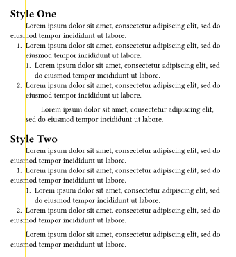 
    <details>
    <summary>Code:</summary>

    ```typst
    #set page(height: auto, margin: 15pt, width: 12cm)

    #import "@local/itemize:0.3.0" as el

    #let v-line = context {
      let height = if page.height == auto {
        12cm // debug
      } else {
        page.height
      }
      box(outset: (top: height, bottom: height), stroke: 1pt + yellow)
    }
    #let indent = 2em
    #set par(first-line-indent: (amount: indent, all: true))

    = Style One
    #lorem(15)
    #[
      #show: el.default-enum-list.with(
        body-margin: ((left: 0em), auto),
        indent: (indent, auto),
        label-indent: it => {
          if it.level == 1 {
            -it.label-width.current - it.e.body-indent
          } else {
            auto
          }
        },
      )
      + #v-line#lorem(15)
        + #lorem(15)
      + #lorem(15)

        #lorem(15)
    ]
    = Style Two
    #lorem(15)
    #[
      #show: el.default-enum-list.with(
        body-margin: ((left: 0em), auto),
        indent: (0pt, 2em, auto),
        label-indent: it => {
          if it.level == 1 {
            2em - (it.label-width.current + it.e.body-indent)
          } else {
            auto
          }
        },
      )
      + #v-line#lorem(15)

        #lorem(15)
        + #lorem(15)
      + #lorem(15)

        #lorem(15)
    ]
    ```
    </details>
  - (*minor change*) `enum-spacing` is now named `whole-spacing`
  - (*minor change*) By default, `auto-base-level` is set to `true`, meaning each `default-*` (`inline-*`, `paragraph-*`) method now maintains its own level counter, starting from 1
    - Note: you can still set `auto-base-level` to `false`, but then at least three iterations are required
  - (*minor change*)`indent` and `body-margin(right)` affect the display of the whole border (you can use `body-format: (whole: (inset: len))` to set the inset width)
  - (*minor change*) Now need to set `checklist` to `true` to enable the checklist feature, which is then configured via `config.checklist` (the `enable` setting has been removed from it)
  - 🆕 Initial support for RTL typesetting
  - Most style parameters now accept a `function` of the form `it => ...`, with the following values available on `it`:
    - 🆕 `it.e` (new): the `enum` or `list` element currently being constructed
    - 🆕 `it.tag` (new)
    - 🆕 `it.elem-tag` (new)
    - 🆕 `it.hanging-type` (new)
    - `it.n`
    - `it.level`
    - `it.n-last`
    - 🆕 `it.number` (new): if the current list is an `enum`, you can access the value of the current item's `it.number`
    - 🆕 `it.marker` (new): if the current list is a `list`, you can access the value of the current item's `it.marker`
    - For horizontal spacing parameters
      - 🆕 `it.parent` (new): the parameter info of the parent containing the current list — the parent's construction element `e`, the item `n` where the parent is located, and the horizontal margin parameters: `label-indent`, `label-inset`, `body-indent`, `indent`, `body-margin`, `label-width` (`max`, `current`)
      - (⚠️ *Breaking change*) `it.get`: access the parameter info of the current list's ancestors by level
    - 🆕 for `label-indent`, `label-inset`, `body-indent`, `indent`, `body-margin`: you can access `label-width` (`max`, `current`)
    - 🆕 for `first-line-inset`, `line-indent`, `hanging-indent`: you can access `label-indent`, `label-inset`, `body-indent`, `indent`, `body-margin`, `label-width` (`max`, `current`)
  - Improve doc
  - Improve diagnostics
  - Most style settings now converge in just two iterations; if you want labels on the same line to align, three iterations are needed, and some advanced styles require four (for example, `auto-label-width` (which depends on the level settings — setting it uniformly needs only three iterations) and `auto-resume-enum`).
  - Fix: the implementation logic of `enum.reversed`
  - Other fixes
    - fix: https://github.com/tianyi-smile/itemize/issues/7
    - (Typst) fix: https://github.com/tianyi-smile/itemize/issues/8 
    - fix: https://github.com/tianyi-smile/itemize/issues/10
    - (Typst) fix: https://github.com/tianyi-smile/itemize/issues/13
    - (Typst) solve: https://github.com/tianyi-smile/itemize/issues/14
    - (Typst) fix: https://github.com/tianyi-smile/itemize/issues/16

## v0.2.0
Breaking Change: ⚠️
New Feature: 🆕 for ver0.2.x

If you were using ver0.1.x, please read this section carefully when upgrading to ver0.2.x, as we have made some changes to the configuration methods.

- Two styles of enum-list: Default (native typst) and Paragraph
- Customize labels and bodies for enums and lists by level and item

  - 🆕 Allow per-item configuration
  - 🆕 Enable loop usage of array element values: `LOOP`
  - 🆕 If a property can be set at both the level and item, it allows passing a function

    - The function format is now standardized as `it => ...`, where you can control it by accessing its properties, typically `it.level` and `it.n`
      - More properties may be added in the future
      - ⚠️ *Breaking change*: Properties related to horizontal spacing now follow this format, and additional properties like `it.label-width` (stores the actual maximum width of the label) and `it.e` (represents the current level's construction object: enum or list) are provided
      - ⚠️ *Breaking change*: Deprecated `level`, `level-count`, and `list-level`
        - Using these methods to configure enum and list properties may sometimes cause "layout did not converge within 5 attempts"
        - In ver0.1.x, per-level and per-item settings for `enum.numbering` can now be combined with the `numbly` package and the `label-format` method
  - 🆕 When using the `*-enum-list` method, you can separately configure enums and lists: `enum-config`, `list-config`
  - Horizontal spacing settings: `indent`, `body-indent`, `label-indent`, `enum-margin` (`is-full-width`)
  - Vertical spacing settings: `item-spacing`, `enum-spacing`
  - Label customization

    - `text-style` (..args)
    - 🆕 `label-align`
    - 🆕 `label-baseline`
    - 🆕 `label-format`
    - 🆕 `label-width`
  - 🆕 Label alignment between items at different levels: `auto-label-width`
  - `auto-base-level`

    - ⚠️  *Breaking change*: When configuring enums and lists using `*-enum-list`, `*-enum`, or `*-list`, the current level is treated as 1
      - Version 0.1.x used absolute levels
    - To maintain compatibility with native behavior, the display of numbering and markers still follows absolute levels. Even if you reconfigure `enum.numbering` and `list.marker` in sublists, their display adheres to absolute level rules
      - In this case, `auto-base-level` is set to `true`, treating the current level as 1
  - Body formatting: `hanging-indent`, `line-indent`

    - 🆕 `body-format`:
      - `text-style`: `style`
      - Border settings: `outer`, `inner`, `whole`: (`stroke`, `radius`, `outset`, `fill`, `inset`)
    - Experimental: `item-format`
- Enum numbering references: `elabel` and `config.ref`

  - ⚠️ The `ref-enum` method from ver0.1.x will be deprecated in the future. Please use `config.ref` for configuration
- Resume enum [`issue#1`](https://github.com/tianyi-smile/itemize/issues/1)

  - 🆕 `auto-resuming`
    - `none`: Disable resume functionality
    - `auto`: Using the following methods:
      - `resume`
      - `resume-label`, `resume-list`
      - `auto-resume-enum`
      - `isolated-resume-enum` (independent sublists)
    - Globally use `true` or `(true, false)` etc. to enable functionality; `false` means the functionality does not apply to this level
- List enhancements

  - Enhanced `list.marker`: Allows passing a `function` parameter in the form of `level => n => content` or `level => array`
  - 🆕 Terms-like functionality: `item`
  - 🆕 Checklist (from the `cheq` package, with minor enhancements and fixes for compatibility with `itemize`)
    - Configure using `config.checklist`
- Add manual
- Fixes

  - Alignment of labels and bodies
  - 🆕 Block-level elements displayed on the same line ([`issue#4`](https://github.com/tianyi-smile/itemize/issues/4))

    - Now better handles blank content in typst, ensuring correct alignment
    - Due to limitations in typst, content within `context` cannot be retrieved in pure typst, making it impossible to correctly process cases like:

      ```typst
      #show: el.default-enum-list
      + #context {block[#text.fill]}
      ```

      - Temporary solution: Use `layout(_ => {...})` instead of `context {...}`, e.g.,
        ```typst
        #show: el.default-enum-list
        + #layout(_ => {block[#text.fill]})
        ```
    - Similarly, output content in `ref(...)` cannot be processed
    - For block-level elements, our handling is more refined compared to native behavior:

      - If a block-level element behaves like a paragraph (`par`, `pad`, `block`, `repeat`, `layout`), it is treated as paragraph behavior, ensuring alignment of labels and bodies within the same paragraph
      - If it is not a paragraph (`block-equation`, `block-raw` `rect`, `table`, `grid`, `stack`, `heading`, `figure`, etc.), it follows native behavior
      - [?] `align` here is paragraph behavior but cannot be correctly implemented (currently follows native behavior)
  - Resolved some cases where "layout did not converge within 5 attempts" occurred

    - However, this may lead to "maximum show rule depth exceeded" when nesting levels increase
    - Mainly occurs with complex configurations of `label-format` and `body-format`
  - Other fixes:

    - Support for `enum.start`
    - ⚠️ *Breaking change*: For compatibility with the native `list.marker` behavior, unlike the methods provided by `itemize`, the level here starts from 0 (see [`issue#3`](https://github.com/tianyi-smile/itemize/issues/3)).

    - [X]  Fixed: Incorrect label display when mixing enums and lists with `*-enum` and `*-list` configurations
      - Now, we rewrite both behaviors of `enum` and `list`, but `*-enum`does not configure list formatting, and similarly for`*-list`
    - [X]  Compatibility with typst 0.14 behavior (`[#6609]` and `[#6242]`)
## v0.1.0 (Initial release)